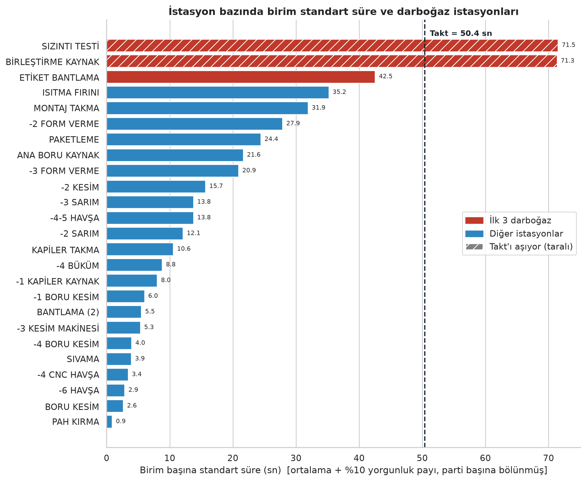
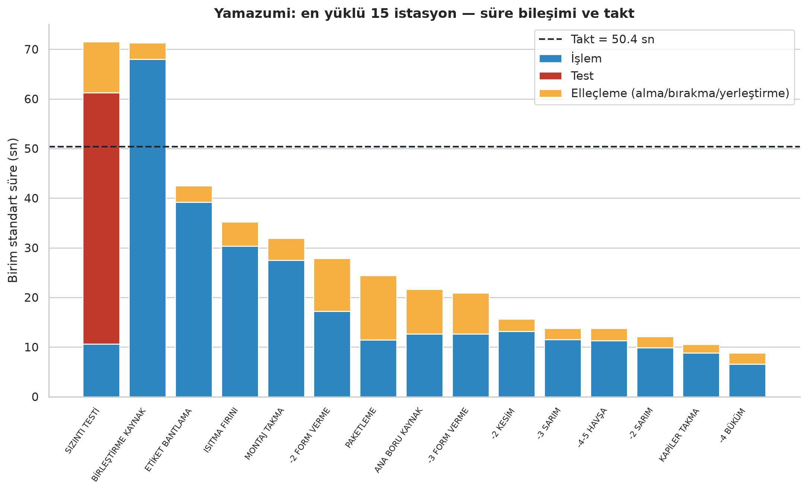
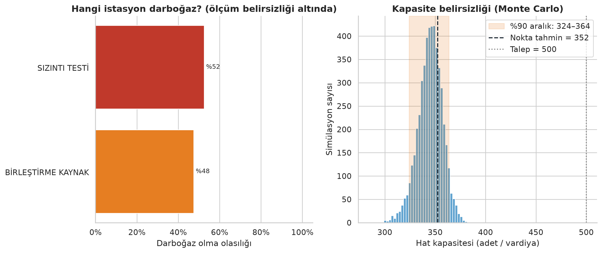
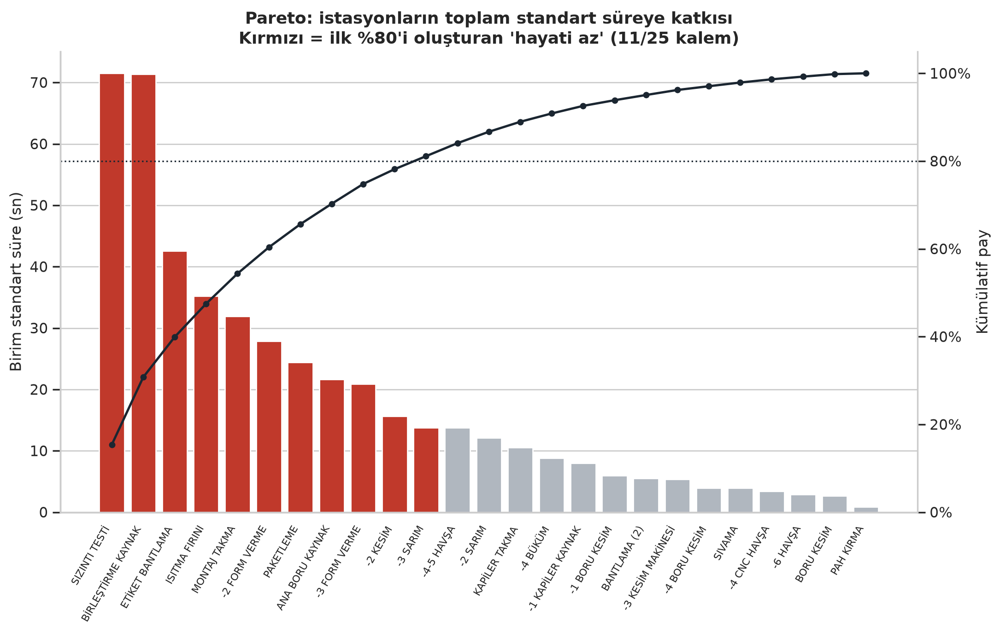
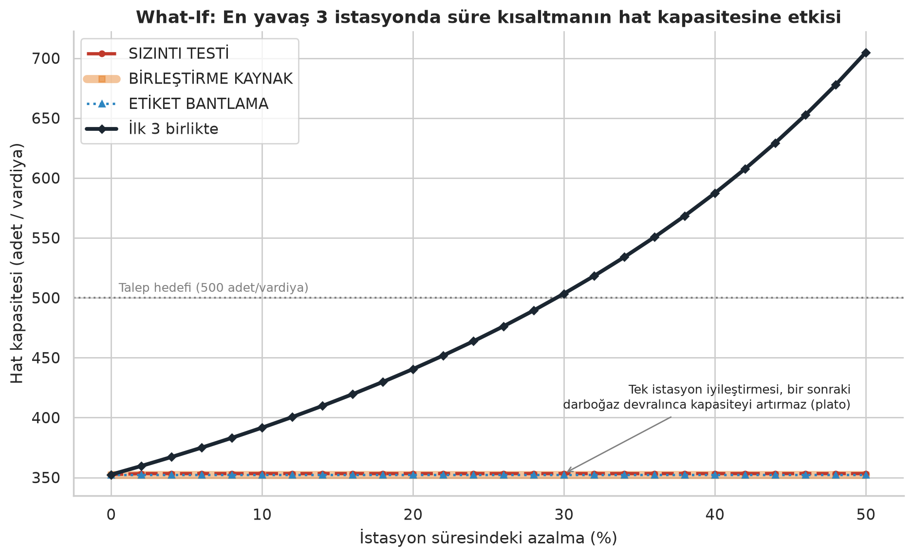

<div align="center">

# 🏭 Üretim Hattı Zaman Etüdü Analizi

**Excel zaman etüdü formlarından → standart süre, takt, darboğaz, hat dengeleme, Pareto, What-If ve Monte Carlo belirsizlik analizine**<br>uçtan uca, tekrarlanabilir bir endüstri mühendisliği hattı.

[](https://github.com/almasaysima/uretim-hatti-zaman-etudu/actions)


[🚀 Hızlı başlangıç](#-hızlı-başlangıç) · [📊 Demo sonuçları](#-demo-sonuçları) · [📘 Vaka çalışması](docs/VAKA_CALISMASI.md) · [📄 Mühendislik raporu](docs/RAPOR.md)



</div>

> **EN (short):** A reproducible Python pipeline that turns Excel time-study forms (stopwatch readings) into unit standard times (10 % PF&D allowance), takt time, bottleneck & line-balancing metrics (LE / balance delay / smoothness index), Pareto, yamazumi, what-if capacity scenarios and a Monte Carlo analysis of how robust the bottleneck conclusion is given few readings. Ships with a synthetic demo dataset, `--anonymize` for safe sharing, tests, Docker and CI.

> ⚠️ **Bu depodaki tüm örnek sonuçlar SENTETİK demo verisinden üretilmiştir** (`src/demo_data.py`); istasyon adları, süreler ve ürün kodu uydurmadır.

## 🎯 Hangi soruları cevaplar?

| Soru | Yöntem |
|---|---|
| Bir ürün her istasyonda **gerçekte ne kadar** sürer? | Ham kronometre okumaları → ortalama → **%10 yorgunluk payı** → **birim standart süre** (parti büyüklüğüne bölünerek) |
| Hat **ne kadar üretebilir**, talebi karşılar mı? | **Takt zamanı**, vardiya kapasitesi, 300–700 adet talep duyarlılığı |
| Kapasiteyi **kim sınırlıyor**, iyileştirince ne kazanırız? | **Darboğaz**, **Pareto**, **Yamazumi**, **What-If** (darboğaz kayması dahil), **hat dengeleme** (LE / BD / SI) |
| Tek-iki okumaya dayanan sonuca **ne kadar güvenebilirim**? | **Monte Carlo**: P(darboğaz) ve kapasite için %90 belirsizlik aralığı |

## 🚀 Hızlı başlangıç

**Docker ile** (veri gerekmez):

```bash
git clone https://github.com/almasaysima/uretim-hatti-zaman-etudu.git
cd uretim-hatti-zaman-etudu
docker build -t zaman-etudu .
docker run --rm -v "$PWD/outputs:/app/outputs" zaman-etudu --demo
```

Windows (cmd) için son satır: `docker run --rm -v "%cd%\outputs:/app/outputs" zaman-etudu --demo`

**Python ile:**

```bash
python -m venv .venv
source .venv/bin/activate        # Windows: .venv\Scripts\activate
pip install -r requirements.txt
python run_analysis.py --demo --open
```

Çıktı: `outputs/tables/` altında 9 CSV, `outputs/figures/` altında 10 grafik ve **`outputs/rapor.html`** — grafikleri, KPI kartlarını ve tabloları tek sayfada gösteren görsel rapor. `--open` bitince raporu tarayıcıda açar; Docker'da tarayıcı açılamaz, `outputs/rapor.html` dosyasına çift tıklayın.

## 📊 Demo sonuçları

*(sentetik veri)*

| Gösterge | Sonuç |
|---|---|
| Hat kapasitesi | ≈ **352 adet/vardiya** (Tmax = 71,5 sn) — Monte Carlo %90 aralığı **324–364** |
| **İkiz darboğaz** | *Sızıntı Testi* 71,5 sn ve *Birleştirme Kaynak* 71,3 sn (2 operatör) — darboğaz olasılıkları **%52 / %48** |
| Tek istasyon iyileştirmesi | Birini %50 hızlandırmak kapasiteyi yalnızca **+%0,2** artırır (diğeri devralır) |
| İlk 3 istasyonda birlikte −%30 | **≈ 503 adet (+%42,9)** → takt (50,4 sn) sağlanır |
| Parti tuzağı | *-1 Kapiler Kaynak* formda 280,5 sn (35'lik parti) → **8,0 sn/adet**, 25 istasyonda 16. |
| Hat dengeleme (LE) | %26,0 tüm istasyonlar · %37,5 ana hat |
| Veri güvenilirliği | 62 öğenin 13'ü tek okuma; yalnızca 1'i Niebel kriterini sağlıyor |

<table>
  <tr>
    <td width="50%"><br><sub><b>Yamazumi</b> — süre bileşimi ve takt</sub></td>
    <td width="50%"><br><sub><b>Monte Carlo</b> — darboğaz olasılığı ve kapasite aralığı</sub></td>
  </tr>
  <tr>
    <td width="50%"><br><sub><b>Pareto</b> — istasyon bazında</sub></td>
    <td width="50%"><br><sub><b>What-If</b> — darboğaz kayması (plato)</sub></td>
  </tr>
</table>

📘 **Vaka çalışması (iş analisti bakışı):** [“Talep 500, Hat 352” — İkiz darboğazın analizi](docs/VAKA_CALISMASI.md) — paydaşlar, kök neden, seçenek/maliyet-fayda karşılaştırması, karar kapılı yol haritası, KPI ve riskler. Tüm grafikler ve ayrıntılı yorum: [docs/RAPOR.md](docs/RAPOR.md).

## 📂 Kendi verinizle kullanım

```bash
python run_analysis.py --input data/raw/etut.xlsx --demand 400 --available-time 25200

# herkese açık paylaşım için istasyon/öğe adlarını ve ürün kodunu maskele:
python run_analysis.py --input data/raw/etut.xlsx --anonymize --output outputs_private/anon

# Docker ile:
docker run --rm -v "$PWD/data:/app/data" -v "$PWD/outputs:/app/outputs" zaman-etudu --input data/raw/etut.xlsx
```

<details>
<summary><b>Excel form yerleşimi</b> (her istasyon bir sayfa)</summary>

<br>

Sütun numaraları `src/config.py` içinde değiştirilebilir.

| Alan | Konum |
|---|---|
| Başlık satırı | A sütunu `KOD` ile başlar (ilk 15 satır içinde); hemen altındaki satır *meta* satırıdır |
| Meta satırı | A: ürün kodu (`<ürün>` veya `<ürün>-1,2` → hat kolu) · T: operasyon adı · AA: `"2 OPERATÖR …"` notu · AK: tarih |
| İş öğesi satırı | B: tür (İşlem / Test / Alma-Yerleştirme / Bırakma) · C: öğe adı · AK: ortalama · AM: standart süre |
| Okumalar | İş öğesi satırının **altındaki satırda** D…AJ sütunları |
| Alt not | `"10 ürünün süresi alındı"` (parti büyüklüğü) · `"STANDART SÜRE … = 70"` |

Zaman etüdü formu olmayan sayfalar (ör. ERP rota tablosu) otomatik atlanır. Operatör/analist isimleri **bilinçli olarak okunmaz** (KVKK). Örnek dosya: [`data/sample/demo_zaman_etudu.xlsx`](data/sample/demo_zaman_etudu.xlsx).

</details>

<details>
<summary><b>Komut satırı argümanları</b></summary>

<br>

| Argüman | Varsayılan | Açıklama |
|---|---|---|
| `--demo` | – | Sentetik demo verisini kullanır |
| `--input` | – | Zaman etüdü Excel dosyası |
| `--demand` / `--available-time` | 500 / 25200 | Vardiya talebi (**yer tutucu**) ve net çalışma süresi (sn) → takt |
| `--product-code` | otomatik | Hat kolu ayrıştırması için ürün kodu |
| `--sims` / `--seed` | 5000 / 42 | Monte Carlo simülasyon sayısı / tohum |
| `--open` | kapalı | Bitince `rapor.html`'i tarayıcıda açar |
| `--anonymize` | kapalı | İstasyon → `İST-01…`, öğe → `Öğe N`, kod ve operasyon adı silinir |

</details>

<details>
<summary><b>Metodoloji</b> (formüller ve varsayımlar)</summary>

<br>

$$T_s=\bar{T}_m\,(1+0{,}10)\qquad T_{s,birim}=\frac{T_{s,parti}}{\text{parti}}\qquad Takt=\frac{\text{net süre}}{\text{talep}}\qquad Kapasite=\frac{\text{net süre}}{T_{max}}$$

$$LE=\frac{\sum T_i}{n\,T_{max}}\qquad BD=1-LE\qquad SI=\sqrt{\sum (T_{max}-T_i)^2}\qquad N_{min}=\left\lceil\frac{\sum T_i}{Takt}\right\rceil$$

- **Doğrulama:** Ortalama ham okumalardan yeniden hesaplanıp formdaki `AK/AM` ile ve yukarı yuvarlanmış "STANDART SÜRE" ile karşılaştırılır.
- **Rating yok:** Formlarda performans değerlendirme faktörü bulunmadığından gözlenen ortalama = normal süre (%100) kabul edilir.
- **Pareto:** İstasyon ve iş öğesi düzeyinde; kümülatif ilk %80 → "hayati az".
- **What-If:** Süre −%10/−20/−30, 2. paralel istasyon (süre ÷2), baskın öğe −%25; her biri tek istasyon ve ilk 3 birlikte. Kapasite her seferinde yeniden hesaplanır → **darboğaz kayması** görünür.
- **Örneklem yeterliliği (Niebel):** $N'=\left(\frac{40\sqrt{n\sum x^2-(\sum x)^2}}{\sum x}\right)^2$ (%95 güven, ±%5 hata).
- **Monte Carlo (`src/uncertainty.py`):** Her öğenin ortalaması, `CV/√n` göreli standart hatasıyla lognormal örneklenir (<3 okumalı öğelerde havuz CV). Yalnızca *örnekleme* belirsizliğini modeller; rating ve yöntem farkını kapsamaz. En yavaş istasyonun maksimumu alındığından nokta tahmin hafif **iyimserdir**.

</details>

<details>
<summary><b>Depo yapısı</b></summary>

<br>

```
├── run_analysis.py             # CLI: uçtan uca çalıştırır
├── src/
│   ├── config.py               # parametreler: yorgunluk payı, takt, form sütunları
│   ├── loader.py               # Excel formu → tidy DataFrame, standart süre
│   ├── metrics.py              # özet, takt, LE/BD/SI, Pareto, kol bazlı dengeleme
│   ├── whatif.py               # What-If motoru ve kapasite eğrileri
│   ├── uncertainty.py          # Monte Carlo belirsizlik analizi
│   ├── anonymize.py            # paylaşım için maskeleme
│   ├── demo_data.py            # sentetik demo Excel üretici
│   ├── report_html.py          # tek dosyalık görsel rapor (rapor.html)
│   └── plots.py                # 10 grafik (Matplotlib/Seaborn)
├── tests/                      # 20 test (sentetik veriyle, veri gerektirmez)
├── data/sample/                # demo Excel (data/raw/ git'e eklenmez)
├── outputs/                    # demo çıktıları (CSV + PNG)
├── scripts/vaka_secenekler.py  # vaka çalışmasındaki seçenek karşılaştırması
├── docs/RAPOR.md               # mühendislik raporu, yönetici özeti, Kaizen planı
├── docs/VAKA_CALISMASI.md      # iş analisti vakası
└── Dockerfile · docker-compose.yml · Makefile · .github/workflows/ci.yml
```

</details>

## ✅ Testler

```bash
pip install -r requirements-dev.txt
python -m pytest            # veya: make test
```

Kapsam: Türkçe normalizasyon, sınıflandırma, ürün kodu/kol ayrıştırma, formla birebir eşleşme, %10 pay, parti normalizasyonu, 2 operatörlü istasyon, What-If darboğaz kayması, Monte Carlo (tekrarlanabilirlik, daha çok okuma → daha az belirsizlik), anonimleştirme ve CLI uçtan uca.

## ⚠️ Sınırlılıklar

- **Takt/talep bir varsayımdır** (500 adet/vardiya, 7 net saat); darboğaz *sıralaması* takt'tan bağımsızdır.
- **Tek seri hat varsayımı:** Paralel alt montaj kolları da dahil olduğundan LE/BD "israf" değil **dengesizlik göstergesi**dir; ana hat ve kol bazlı değerler ayrıca raporlanır. Gerçek öncelik ilişkileri (RPW/LCR) modellenmemiştir.
- Çok operatörlü istasyonda süre **çevrim süresi** kabul edilir; emek içeriği daha yüksek olabilir.
- What-If sonuçları **teorik** kapasitedir; kalite onayı ve yatırım gerektirebilir.

## 🗺 Yol haritası

- [ ] Öncelik ilişkileriyle gerçek hat dengeleme (RPW / LCR)
- [ ] Ayrık-olay simülasyonu (SimPy): ara stok, operatör paylaşımı
- [ ] Rating faktörü desteği ve Excel şablonu
- [ ] Streamlit panosu

## 📄 Lisans

MIT — bkz. [`LICENSE`](LICENSE).

<sub>Hazırlayan: Aysima Almas · Endüstri Mühendisliği · [LinkedIn](https://www.linkedin.com/in/aysimaalmas) · almasaysima@gmail.com</sub>
