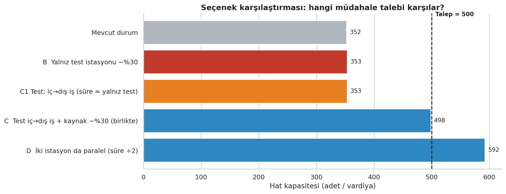

# Vaka Çalışması: “Talep 500, Hat 352” — İkiz Darboğazın İş Analizi

> **Veri notu:** Bu vaka, depodaki **sentetik demo verisiyle** yazılmıştır (`python run_analysis.py --demo`). İstasyon adları, süreler ve **tüm mali değerler uydurmadır**; amaç, bir iş analistinin sorunu nasıl çerçevelediğini, seçenekleri nasıl değerlendirdiğini ve öneriyi nasıl savunduğunu göstermektir. Seçenek hesapları `python scripts/vaka_secenekler.py` ile yeniden üretilir.

## 1. Vaka özeti

Bir boru–kaynak–test montaj hattında planlama birimi vardiyada **500 adet** talep ediyor; mevcut standart sürelerle hat **≈352 adet** üretebiliyor (≈%30 açık). Üretim, açığı fazla mesaiyle kapatmaya çalışıyor. Analiz, kapasiteyi **iki istasyonun birlikte** sınırladığını gösteriyor; bu yüzden “en yavaş istasyonu iyileştirelim” refleksi neredeyse hiçbir kazanç getirmiyor. Vaka, doğru müdahaleyi ve onun ölçülebilir kabul kriterlerini belirliyor.

## 2. İş sorunu ve hedef

| | |
|---|---|
| **Sorun ifadesi** | Hat kapasitesi (≈352 adet/vardiya) talebin (500) altında; fark fazla mesai ve teslimat riskiyle karşılanıyor. |
| **Hedef (SMART)** | 12 hafta içinde hat kapasitesini **≥500 adet/vardiya**’ya çıkarmak (Tmax ≤ 50,4 sn), **test kalitesini düşürmeden** ve fazla mesaiyi sıfırlayarak. |
| **Kapsam içi** | Darboğaz istasyonlarının süre/iş akışı iyileştirmesi, ölçüm planı, KPI’lar |
| **Kapsam dışı** | Yeni hat kurulumu, ikinci vardiya, ürün tasarımı değişikliği, talep tahmini |
| **Varsayımlar** | Talep 500/vardiya; net süre 25.200 sn; rating yok (Tn = Tm); %10 yorgunluk payı |

## 3. Paydaşlar

| Paydaş | İlgisi | Rol |
|---|---|---|
| Üretim müdürü | Teslimat, fazla mesai maliyeti | Sponsor / karar verici |
| Planlama | Talep ve takt tanımı | Danışılan (talep doğrulaması) |
| Proses / metot mühendisi | Süre ölçümü, iş akışı | Sorumlu |
| Kalite | Test yeterliliği, kaçak yakalama | **Onaylayan** (test süresine dokunan her değişiklik) |
| Bakım | Aparat, kabin, ekipman | Katkı |
| Operatörler | Günlük uygulama, kabul | Danışılan / eğitilen |
| Finans | Yatırım ve geri ödeme | Bilgilendirilen |

## 4. Mevcut durum (AS-IS)

- **Tmax = 71,5 sn** (*Sızıntı Testi*); hemen ardından **71,3 sn** ile *Birleştirme Kaynak* (2 operatör). Takt = 50,4 sn; üçüncü istasyon 42,5 sn ile takt altında.
- Fark yalnızca **0,2 sn**: hangisinin darboğaz olduğu veriyle ayırt edilemiyor. Monte Carlo (5.000 sim.) darboğaz olasılığını **%52 / %48**, kapasite için %90 aralığı **324–364** buluyor.
- Fazla mesaiyle talebi karşılamak vardiya başına **≈2,9 saat** (≈%42) ek çalışma demektir.
- Veri zayıf: 62 öğenin 13'ü tek okuma; yalnızca 1'i örneklem yeterliliği kriterini sağlıyor.

## 5. Kök neden analizi

**5 Neden (Sızıntı Testi):** Hat talebi karşılamıyor → test istasyonu 71,5 sn → **test 50,6 sn + operatör öğeleri 20,9 sn** (yerleştirme, prob kontrol, bırakma) → operatör öğeleri test **bittikten sonra/başlamadan önce** sıralı yürütülüyor → tek aparat/kabin; test sürerken yerleştirme yapılamıyor.

| # | Hipotez | Dayanak (demo veri) | Nasıl doğrulanır? |
|---|---|---|---|
| H1 | Test istasyonunda **iç iş dış işe** çevrilebilir (mekik tabla / ikinci aparat) | Operatör öğeleri 20,9 sn, testin %41'i | İnsan-makine çalışma diyagramı; video etüdü |
| H2 | Kaynak istasyonunda iki operatör **sıralı** çalışıyor; iş dağılımı dengesiz | *Kaynak hazırlık* 32,1 sn (yüksek değişkenlik, CV ≈%25), *Kaynak* 25,7 sn, geri kalan 13,5 sn | Çok operatörlü çalışma diyagramı; hazırlığı paralel yürütme denemesi |
| H3 | Hazırlıktaki yüksek değişkenlik **aparat/mastar eksikliğinden** | 5 okumada geniş yayılım | ≥10 okumalı yeniden ölçüm; ilk çevrim ayrı etiketleme |
| H4 | Ölçüm hatası sıralamayı etkiliyor | İki istasyon arası fark 0,2 sn | Faz 0 yeniden ölçüm |

> Bunlar **hipotezdir**; analiz bunları kanıtlamaz, doğrulama planını belirler.

## 6. Seçenekler ve değerlendirme

| Seçenek | Kapasite | Talebe açık | Yıllık ek katkı* | Yatırım* | Geri ödeme* |
|---|---:|---:|---:|---:|---:|
| **A** Fazla mesai (mevcut) | 352 (+2,9 sa/vardiya) | 0 (mesaiyle) | – | sürekli işgücü maliyeti | – |
| **B** Yalnız test istasyonu −%30 | 353 | 147 | ≈4 bin TL | 60 bin TL | ≈177 ay |
| **C** Test iç→dış iş **+** kaynak −%30, **birlikte** | **498** | 2 | **≈728 bin TL** | 150 bin TL | **≈2,5 ay** |
| **D** İki istasyonda paralel kapasite (süre ÷2) | 592 | 0 | ≈738 bin TL | 1,2 milyon TL | ≈19,5 ay |

\* Varsayım: katkı marjı 20 TL/adet, 250 vardiya/yıl, yatırım tutarları tahmini (`scripts/vaka_secenekler.py` başındaki sabitler). Satış talebi 500 ile sınırlı olduğundan D'nin ek 92 adetlik kapasitesi bugün gelir üretmez; yalnızca büyüme payıdır.

**Ağırlıklı karar matrisi** (puanlar 1–5, analistin yargısıdır; ağırlıklar paydaşlarla tartışılır):

| Kriter (ağırlık) | A | B | C | D |
|---|---:|---:|---:|---:|
| Kapasite etkisi (%35) | 3 | 1 | 4 | 5 |
| Maliyet (%25) | 2 | 4 | 4 | 1 |
| Uygulama hızı (%15) | 5 | 4 | 4 | 2 |
| Risk (%15) | 3 | 4 | 3 | 3 |
| Esneklik / büyüme (%10) | 1 | 1 | 3 | 5 |
| **Ağırlıklı skor** | 2,85 | 2,65 | **3,75** | 3,25 |

**Bu analizin üç kritik içgörüsü**
1. **B ve “yalnız test iç→dış iş” (C1) kapasiteyi artırmaz (352 → 353).** Kaynak istasyonu devralır; iyileştirme yalnızca *birlikte* değer üretir.
2. **C bile tek başına talebi tam karşılamaz: 498 < 500.** İç→dış iş dönüşümünün teorik sınırı test süresinin kendisidir (≈50,6 sn), bu da takt'ın (50,4 sn) 0,2 sn üstündedir. Test çevriminde ≈%1 ek kısalma (parametre/fikstür) veya takt tanımının netleştirilmesi gerekir.
3. **Fazla mesai (A) bir çözüm değil, açığın bedelini her gün ödemektir.**

## 7. Öneri

**Seçenek C'yi, aşamalı ve karar kapılı uygulayın; D'yi yalnızca kapı koşuluna bağlayın.**

| Faz | Süre | İçerik | Karar kapısı |
|---|---|---|---|
| **0 – Doğrula** | Hafta 0–2 | Planlama ile gerçek talep/takt; iki istasyonda ≥10 okumalı ölçüm; çalışma diyagramları (H1, H2) | **G1:** İki istasyonun sıralaması ve farkı netleşti mi? Hipotezler doğrulandı mı? |
| **1 – Birlikte iyileştir** | Hafta 2–8 | Test: mekik tabla/ikinci aparat; kaynak: hazırlık aparatı ve iş dağılımı; test süresi için kalite onaylı küçük kısalma | **G2:** Her iki istasyon **Tmax ≤ 50,4 sn** (ölçülmüş) mü? |
| **2 – Standartlaştır** | Hafta 8–12 | SOP, standart süre güncelleme, operatör eğitimi, 5 ardışık vardiyada çıktı doğrulaması | **G3:** ≥500 adet/vardiya ve fazla mesai = 0 |

**Karar kuralları:** G2'de bir istasyon hedefi tutturamazsa yalnızca **o istasyon** için D değerlendirilir (yatırım onayına gider). Talep ≈550'nin üzerine çıkarsa D büyüme yatırımı olarak yeniden ele alınır. Etiket Bantlama (42,5 sn) 592 adet üzerinde yeni darboğaz olur; izlenir.

## 8. Gereksinimler (MoSCoW) ve kabul kriterleri

| Öncelik | Gereksinim | Kabul kriteri |
|---|---|---|
| Must | İki darboğaz istasyonu ≤ takt | ≥10 okumalı ölçümde standart süre ≤ 50,4 sn |
| Must | Test kalitesi korunur | Kalite onaylı doğrulama; kaçak yakalama oranı değişmez |
| Must | Fazla mesai sıfırlanır | 5 ardışık vardiyada ≥500 adet, ek mesai yok |
| Should | Süreçler standartlaştırılır | Güncel SOP ve standart süre formu |
| Could | Yamazumi panosu, aylık otomatik rapor | `run_analysis.py` aylık çalışır |
| Won't (bu kapsamda) | Yeni hat / ikinci vardiya | – |

## 9. KPI ve ölçüm planı

| KPI | Mevcut | Hedef | Sıklık |
|---|---:|---:|---|
| Hat kapasitesi (adet/vardiya) | ≈352 | ≥500 | Haftalık |
| Tmax (sn) | 71,5 | ≤50,4 | Faz sonları |
| Fazla mesai (saat/vardiya) | ≈2,9 | 0 | Günlük |
| Test kaçak yakalama / ilk geçiş oranı | – (referans alınacak) | Değişmemeli | Günlük |
| Öğe başına okuma sayısı / CV | 1–5 / değişken | ≥10 / <%15 | Faz 0 |

## 10. Riskler

| Risk | Olasılık | Etki | Önlem |
|---|---|---|---|
| Test süresi kısaltılırken **kaçak kaçırma** (kalite) | Orta | Yüksek | Kalite onayı, kademeli deneme, referans numuneyle doğrulama |
| Teorik sınır (≈50,6 sn) takt'ı karşılamıyor | Yüksek | Orta | Test çevriminde ek %1; takt tanımının planlamayla netleştirilmesi |
| Ölçüm hatası yanlış istasyona odaklatır | Orta | Yüksek | Faz 0 yeniden ölçüm; iki istasyona birlikte çalışmak |
| 2 operatör varsayımı yanlış (çevrim ≠ emek) | Orta | Orta | Çok operatörlü çalışma diyagramı |
| Talep varsayımı (500) değişir | Orta | Orta | Takt duyarlılık tablosu (300–700) ile yeniden hesap |
| Operatör direnci / eğitim eksikliği | Orta | Orta | Operatörleri etüde dahil etme, SOP + eğitim |

## 11. Sonuç ve çıkarımlar

- Sorun “bir istasyon yavaş” değil, **iki istasyonun birlikte kapasiteyi belirlemesidir**; analiz bu yüzden tek hedefli iyileştirmenin neden boşa gideceğini sayıyla gösterir.
- Önerinin kazancı (≈498 adet) talebin hemen altında kalır; **dürüst analiz kalan 2 adedi ve nedenini açıkça söyler**, çözümü de (test çevrimi / takt netleştirme) önerir.
- Veri yetersizliği analizin sonucunu değiştirmez ama **müdahale sırasını** değiştirir: önce ölçüm, sonra yatırım.

*Bu vakanın sınırları:* sentetik veri, varsayımsal mali değerler, doğrulanmamış hipotezler. Gerçek bir uygulamada Faz 0 çıktıları bu tabloların yerine geçer.
